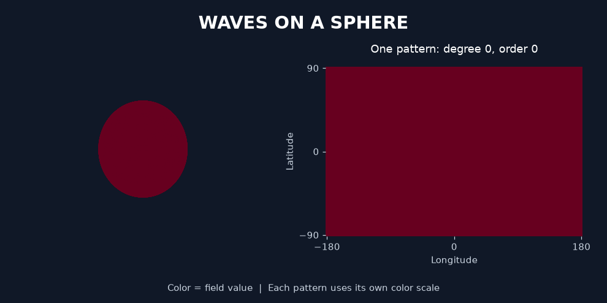

# Волны на сфере

**Как собрать поле из узоров — интерактивное введение в спектральное представление.**

От обычных синусов до сферических гармоник: выбираем узоры, собираем из них карту и смотрим, что исчезает при удалении мелких деталей.




[**Открыть ноутбук →**](spectral_representation.ipynb) · [](https://colab.research.google.com/github/tanyamr/Waves-on-a-sphere/blob/main/spectral_representation.ipynb)

## Что здесь происходит

Скалярное поле на сфере задаёт числовое значение в каждой точке поверхности, например температуру. Его можно представить значениями в узлах сетки или коэффициентами разложения по сферическим гармоникам — базисным функциям, описывающим пространственные структуры разного масштаба.


| Шаг | Эксперимент | Что можно понять |
|---|---|---|
| 1. Обычные волны | Складываем синусы и косинусы | Как веса меняют общий сигнал |
| 2. Узоры на сфере | Выбираем степень ℓ и порядок m | Как выглядит одна сферическая гармоника |
| 3. Карта и рецепт | Находим веса по значениям на сетке | Два способа записать одно поле |
| 4. Убираем детали | Меняем предел L | Что теряется при усечении |
| 5. Вычисления | Возводим поле в квадрат | Зачем переходить между сеткой и коэффициентами |

## Запустить локально
Python 3.11 или новее

```bash
python3 -m venv .venv
source .venv/bin/activate
python -m pip install -r requirements.txt
python -m jupyterlab spectral_representation.ipynb
```

## Первые эксперименты

После выполнения соответствующих ячеек ноутбука можно вызвать функции в новой ячейке.

**Посмотреть один узор:**

```python
harmonic(ell=2, m=0)
harmonic(ell=5, m=3)
```

Каждый вызов показывает один узор. `ell` выбирает степень, а `m` — вариант внутри этой степени: от `-ell` до `ell`. Это не количество складываемых узоров.

**Изменить количество узоров в поле:** найди `recipe` в шаге 3. Одна запись — один узор с заданным весом:

```python
recipe = {
    (0, 0): 0.5,
    (1, 0): 1.4,
    (2, 2): 1.0,
}
```

Этот рецепт складывает три узора. Добавляй или удаляй записи и выполняй шаг 3 и следующие ячейки заново. В текущем примере используй степени не выше `MAX_L = 8`.

**Убрать мелкие детали:** после выполнения шага 4 сравни:

```python
truncate(L=2)
truncate(L=8)
```

Для исходного рецепта `L=8` сохраняет все пять составляющих. Произвольному полю может понадобиться больше гармоник.


## Математическая основа

Используется вещественный ортонормированный базис сферических гармоник. Коэффициенты вычисляются квадратурой Гаусса по синусу широты и равномерной сеткой по долготе. В ноутбуке есть проверки ортонормированности, восстановления поля и нормы квадрата поля.

- [SciPy: сферические гармоники](https://docs.scipy.org/doc/scipy/reference/generated/scipy.special.sph_harm_y.html)
- [NIST: определения и свойства сферических гармоник](https://dlmf.nist.gov/14.30)
